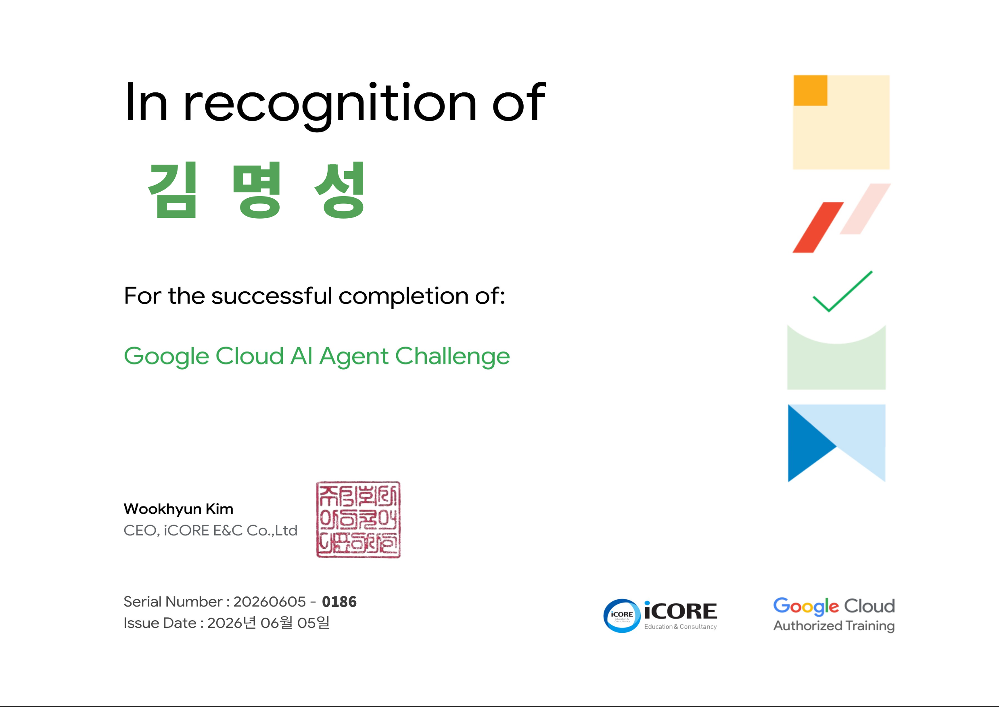

# 🧑🏻‍💻 김명성 | Myeongseong Kim

### AI Developer · Machine Learning · Problem Solving

> Turning AI ideas into practical software solutions.

---

## 🎓 Highlights

- 🥈 Google AI Agent Challenge 2026 **우수상 수상**
- 🏅 Solved.ac **Gold V**
- 💻 T-LAB (Technology Startup Advanced Lab)
- 🎓 **Big Data MicroDegree** · Beginner Level · Handong Global University *(2026.08.21)*
- 🎓 Handong Global University · AI Computer Engineering

## 💼 Experience

- Data Search Intern · **Impactive-AI**
  - 2026.06.29 ~ 2026.08.28

<!--
## 🏅 Google AI Agent Challenge 2026

### Award Certificate

  

Google Cloud AI Agent Challenge 2026 우수상 수상

---
-->

<!--
## 🏅 Problem Solving

---
-->

## 🚀 Activities

- **2026 경북 스타트업 AI 콘텐츠 마케팅 해커톤**
  - AI 콘텐츠 기획·제작 및 마케팅 프로젝트 과정 수료 · 2026.10.17

## 📫 Contact

- 📧 Email : proudchris@icloud.com
- 📝 Blog : https://drum-computer.tistory.com/
- 💼 LinkedIn : https://www.linkedin.com/in/myeongseong-kim-b87038402

---

